<div align="center">
  
  <h1>fernandovazquez.dev</h1>
  <p>
    The third iteration of <a href="https://fernandovazquez.dev/">fernandovazquez.dev</a>, built with <a href="https://astro.build">Astro</a>, hosted on cloudflare.
  </p>
  <p align="center">
    Previous iterations:
    <a href="https://github.com/fevazquez/v1" target="_blank">v1</a>,
    <a href="https://github.com/fevazquez/v2" target="_blank">v2</a>
  </p>


</div>

<br />

<!-- Table of Contents -->

# :notebook_with_decorative_cover: Table of Contents

- [About the Project](#star2-about-the-project)
  - [Tech Stack](#space_invader-tech-stack)
  - [Features](#dart-features)
  - [Color Reference](#art-color-reference)
- [Getting Started](#toolbox-getting-started)
  - [Project Structure](#-project-structure)
  - [Run Locally](#running-run-locally)
- [Contact](#handshake-contact)
- [Acknowledgements](#gem-acknowledgements)

## :star2: About the project

### :space_invader: Tech Stack

- **Framework & UI:** Astro, React
- **Testing:** Vitest, Playwright, React Testing Library, `@vitest/coverage-v8`
- **CI/CD & Quality:** CircleCI, Qlty, Dependabot, ESLint (`eslint-plugin-astro`, `jsx-a11y`)
- **Hosting:** Cloudflare

### :art: Color Reference

| Color           | Hex                                                              |
| --------------- | ---------------------------------------------------------------- |
| Primary Color   |  #1b1b1b |
| Secondary Color |  #141414 |
| Accent Color    |  #fff8e7 |
| Text Color      |  #8892b0 |

## :toolbox: Getting Started

### :construction: Project structure

Pages and the layout are Astro; every UI component is a React component, as in v2. Only the header menu and the experience tabs are hydrated in the browser, the rest renders to static HTML at build time.

```text
public/                     static files (images, resume PDF)
src/
  layouts/Layout.astro      page shell: head, splash, header, side rails, footer
  pages/index.astro         composes the sections
  components/
    header/  hero/  about/  experience/  notfound/ projects/  contact/
    footer/  splash/  sidebars/  icons/
                            each folder holds a .jsx component and its .css
  styles/global.css         theme tokens (dark and light), base styles, shared utilities
```

### :running: Run Locally

```bash
npm install
npm run dev      # http://localhost:4321
npm run build    # static output in dist/
```

Edit the page in `src/pages/index.astro`. To add a project, add another `<Project ... />` in `src/components/projects/Projects.jsx`.

<!-- Contact -->

## :handshake: Contact

Fernando Vazquez - f4vazquez@gmail.com

Project Link: [fernandovazquez.dev](https://www.fernandovazquez.dev)

<!-- Acknowledgments -->

## :gem: Acknowledgements

- [Shields.io](https://shields.io/)
- [Emoji Cheat Sheet](https://github.com/ikatyang/emoji-cheat-sheet/blob/master/README.md#travel--places)
- [Readme Template](https://github.com/Louis3797/awesome-readme-template)
